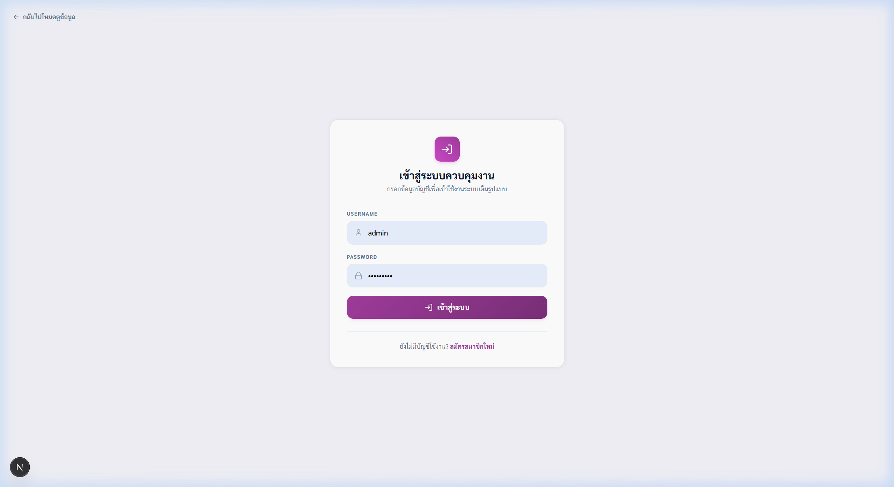
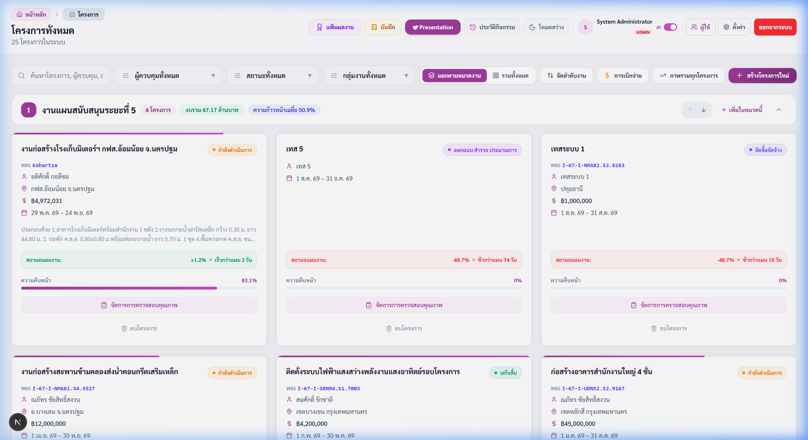
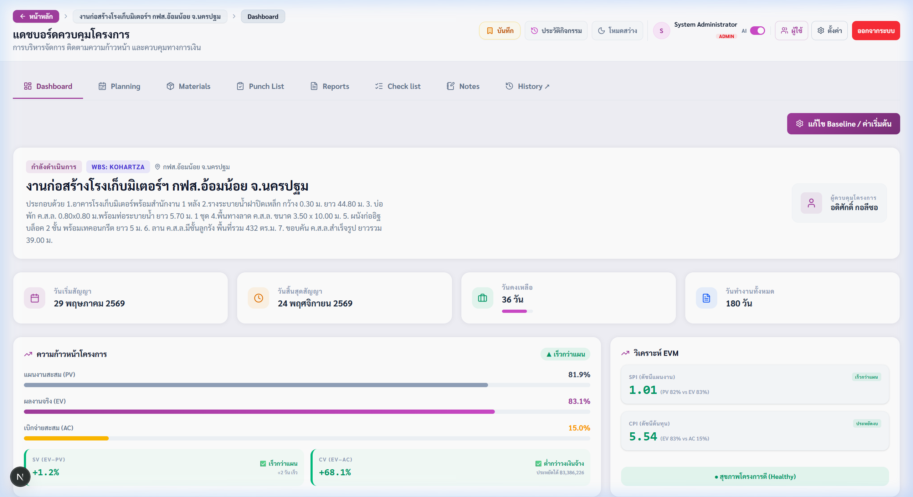
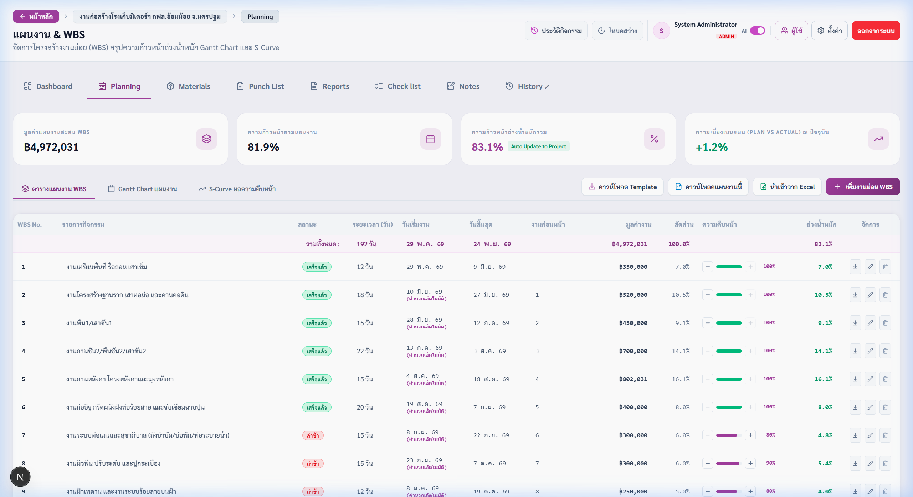
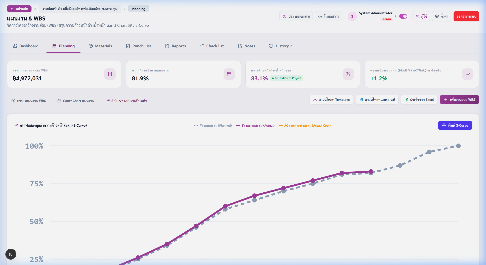
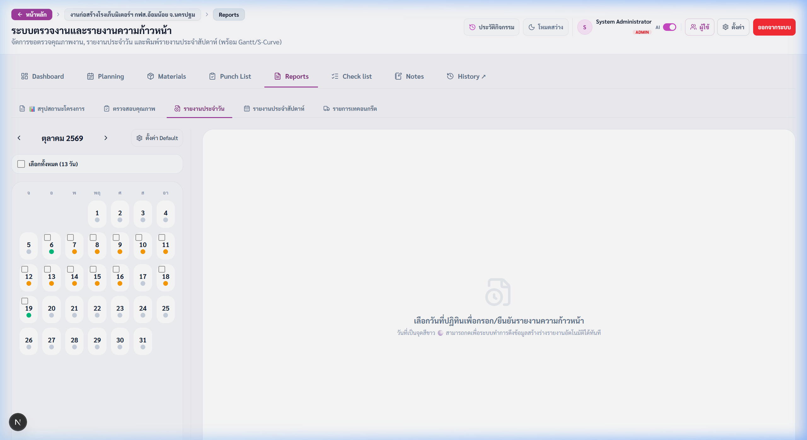
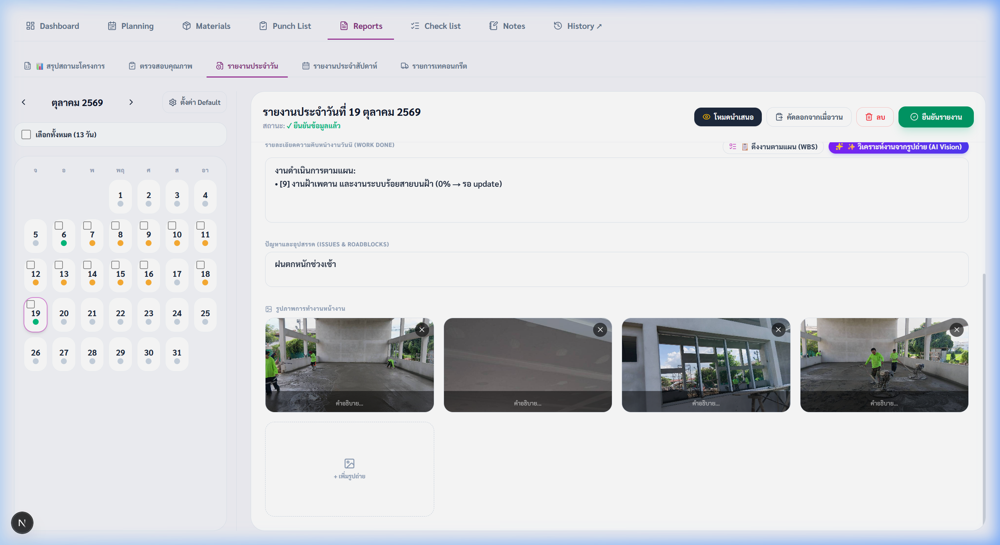
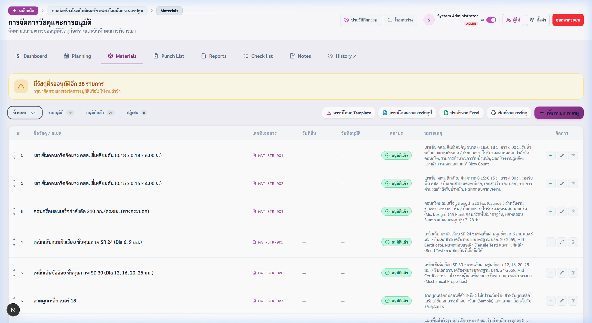
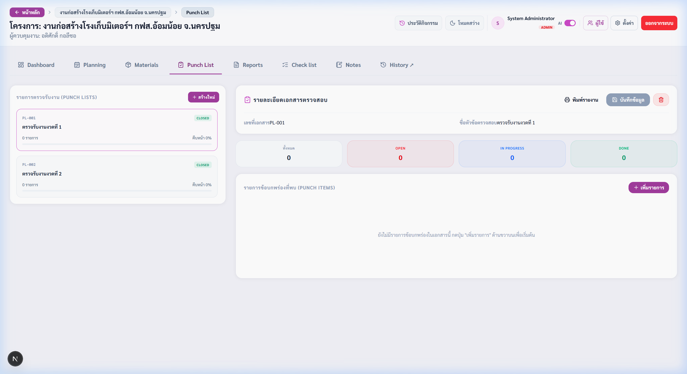
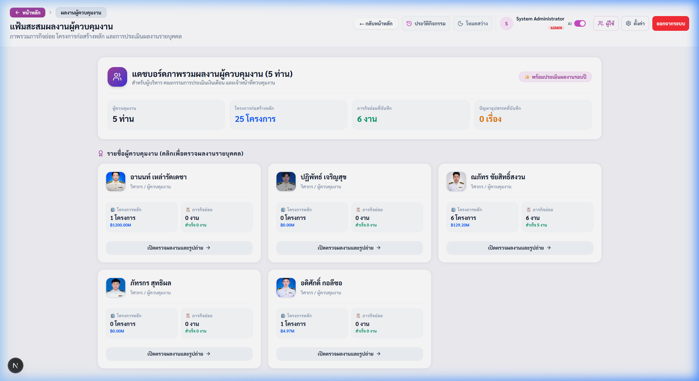

# คู่มือการใช้งานระบบติดตามงานก่อสร้าง (User Manual) ฉบับสมบูรณ์
**Construction Project Tracking & Management System**  
*เวอร์ชัน 1.2.0 (พร้อมระบบ Quick Progress Stepper & AI Daily Report Analysis)*

---

## 📋 ข้อมูลเอกสาร
- **ชื่อเอกสาร:** คู่มือผู้ใช้งานระบบติดตามงานก่อสร้างฉบับสมบูรณ์
- **หน่วยงาน / ฝ่าย:** ฝ่ายควบคุมและกำกับการก่อสร้าง / กองวิศวกรรม
- **วันที่จัดทำ:** 19 ตุลาคม 2569
- **สถานะเอกสาร:** ฉบับเผยแพร่ใช้งานจริง (Official Release)

---

# บทนำและสิทธิ์การใช้งาน (Introduction & Roles)

ระบบติดตามงานก่อสร้าง (Construction Tracking Platform) ถูกออกแบบและพัฒนาขึ้นเพื่อยกระดับการควบคุมงานก่อสร้างให้เป็นระบบดิจิทัลแบบครบวงจร รองรับการทำงานร่วมกันระหว่างผู้บริหาร (Executive), นายช่างผู้ควบคุมงาน (Site Supervisor), ผู้ตรวจสอบ (Inspector) และผู้รับเหมา โดยมุ่งเน้นการบันทึกข้อมูลหน้างานที่สะดวก รวดเร็ว และประมวลผลความคืบหน้าแบบ Real-time

| บทบาท (Role) | สิทธิ์การใช้งาน (Permissions) | กลุ่มผู้ใช้งานเป้าหมาย |
| :--- | :--- | :--- |
| **Admin (ผู้ดูแลระบบ)** | สิทธิ์สูงสุด: เพิ่ม/ลบโครงการ, จัดการบัญชีผู้ใช้, กำหนดค่าระบบ, อนุมัติเอกสาร | ผู้ดูแลระบบ, ผู้จัดการโครงการอาวุโส |
| **Editor (ผู้คุมงาน/ผู้บันทึก)** | บันทึกรายงานประจำวัน, ปรับความคืบหน้า WBS, ส่งอนุมัติวัสดุ, บันทึก Defect | นายช่างผู้ควบคุมงานประจำไซต์ (Supervisor) |
| **Viewer (ผู้ชม/ผู้บริหาร)** | ดูภาพรวมแดชบอร์ด, ติดตามผลงานจริงเทียบแผน, ดูกราฟ S-Curve, พิมพ์รายงาน PDF | ผู้บริหาร, คณะกรรมการตรวจรับ, ลูกค้า |

---

# หมวดที่ 1: การเข้าสู่ระบบ (User Login)

1. เปิดเว็บเบราว์เซอร์ (Chrome, Edge หรือ Safari) เข้าสู่ URL ของระบบ จากนั้นกรอก **ชื่อผู้ใช้งาน (Username)** เช่น `admin` และ **รหัสผ่าน (Password)**
2. (ทางเลือก) ติ๊กเครื่องหมายถูกที่ช่อง *"จดจำการเข้าสู่ระบบ"*
3. กดปุ่ม **[ เข้าสู่ระบบ ]** หากรหัสผ่านถูกต้อง ระบบจะนำเข้าสู่แดชบอร์ดหลักทันที และแสดงชื่อผู้ใช้พร้อมสิทธิ์ที่มุมบนขวา

*ภาพที่ 1: หน้าจอเข้าสู่ระบบ (Login Screen) - หน้าต่างเข้าใช้งานและตรวจสอบสิทธิ์*

---

# 1.2 แดชบอร์ดภาพรวมโครงการทั้งหมด (Projects Overview)

เมื่อเข้าสู่ระบบแล้วจะพบกับหน้าหลัก (`/projects`) ซึ่งเป็นศูนย์รวมข้อมูลโครงการทั้งหมดที่กำลังดำเนินการอยู่:
- **การ์ดสถิติรวม (KPI Summary Cards):** แสดงจำนวนโครงการทั้งหมด, โครงการที่กำลังดำเนินการ, โครงการที่ล่าช้า, โครงการที่แล้วเสร็จ และงบประมาณรวม
- **แถบค้นหาและตัวกรอง:** พิมพ์ค้นหาตามชื่อโครงการ หรือชื่อผู้ควบคุมงาน และเลือกกรองสถานะโครงการได้
- **การจัดกลุ่มงาน (Work Grouping):** แสดงรายการโครงการแยกตามหมวดหมู่ หรือสลับมุมมองระหว่างแบบการ์ด (Grid View) และแบบตาราง (Table View)
- **ปุ่มทางลัดด้านบน:** ปุ่ม `[ 📌 บันทึก ]` (Quick Links), ปุ่ม `[ 🎖️ แฟ้มผลงาน ]` (Supervisors) และปุ่ม `[ + เพิ่มโครงการ ]`

*ภาพที่ 2: หน้าแดชบอร์ดภาพรวมโครงการทั้งหมด (Main Projects Overview) - สรุปสถิติและสถานะทุกโครงการ*

---

# หมวดที่ 2: แดชบอร์ดรายละเอียดโครงการและข้อมูลสัญญา (Project Dashboard)

เมื่อคลิกเลือกโครงการใดโครงการหนึ่ง ระบบจะนำเข้าสู่หน้ารายละเอียดโครงการ (`/projects/[id]`):
- **ข้อมูลสัญญาและงบประมาณ:** แสดงเลขที่สัญญา, ผู้รับจ้าง, วงเงินงบประมาณ, ยอดเบิกจ่ายแล้ว และค่าปรับรายวัน
- **กำหนดเวลาและการขยายเวลา:** แสดงวันเริ่มต้นสัญญา, วันสิ้นสุดเดิม และวันสิ้นสุดหลังการขยายเวลาสัญญา
- **ตารางงวดงานและงวดเงิน (Milestones):** สรุปรายละเอียดงวดที่ 1 ถึงงวดสุดท้าย แสดงขอบเขตงาน จำนวนเงิน และสถานะการเบิกจ่าย (`จ่ายแล้ว` หรือ `รอดำเนินการ`)

*ภาพที่ 3: หน้าแดชบอร์ดโครงการ (Project Dashboard) - สรุปงบประมาณ กำหนดเวลา และตารางงวดงาน*

---

# หมวดที่ 3: แผนงาน WBS และปุ่มลัดปรับความคืบหน้า (Planning)

แท็บ **Planning** ใช้สำหรับควบคุมกิจกรรมก่อสร้างย่อยตามหลักวิศวกรรม โดยคำนวณวันทำงาน หักวันหยุดราชการ และรองรับความสัมพันธ์ของงานก่อนหน้า (Predecessors) อัตโนมัติ:

### ปุ่มลัดเพิ่ม-ลดความคืบหน้า (Quick Progress Stepper: [-] / [+])
- กดปุ่ม **`[-]`** เพื่อลดความคืบหน้าลง **10%** (ต่ำสุดที่ 0%)
- กดปุ่ม **`[+]`** เพื่อเพิ่มความคืบหน้าขึ้น **10%** (สูงสุดที่ 100%)
- **ระบบปรับปัดเศษอัตโนมัติ:** หากความคืบหน้าอยู่ที่ 95% แล้วกด `[+]` ระบบจะปรับเป็น 100% ทันที
- **Real-time Update 0ms:** ตัวเลขแถบเปอร์เซ็นต์, สถานะงาน, ความก้าวหน้ารวม และเส้นกราฟ S-Curve ปรับตัวทันที
- **นำเข้าและส่งออก Excel:** กดปุ่ม **`📥 ดาวน์โหลด Template`** เพื่อกรอกแล้วนำเข้าผ่านปุ่ม **`📤 นำเข้าจาก Excel`**

*ภาพที่ 4: ตาราง WBS - แสดงรายการกิจกรรมย่อย พร้อมปุ่มลัด [-] และ [+] ขนาบข้าง Progress Bar*

---

# 3.2 แผนภูมิ Gantt Chart และกราฟเส้น S-Curve

- **Gantt Chart แผนงาน:** แสดงแถบระยะเวลาทำงานของแต่ละกิจกรรม พร้อมเส้น Today Marker แสดงวันที่ปัจจุบัน
- **S-Curve ผลความคืบหน้า:** แสดงเส้นเปรียบเทียบผลงานจริงสะสม (Actual สีน้ำเงิน) กับแผนงานสะสม (Planned สีเทา)
- **ความเบี่ยงเบนแผน (Plan vs Actual):** แสดงตัวเลขประเมินความเร็ว/ช้าของโครงการ เช่น `-5.2%` หากงานล่าช้ากว่าแผน

*ภาพที่ 5: หน้ากราฟเปรียบเทียบผลงาน S-Curve และ Gantt Chart - ตรวจสอบความเบี่ยงเบนของแผนงาน (Plan vs Actual)*

---

# หมวดที่ 4: การบันทึกรายงานประจำวันหน้างาน (Daily Reports)

แท็บ **Reports** ออกแบบมาเพื่อให้นายช่างบันทึกเหตุการณ์ประจำวันได้อย่างครบถ้วนและสะดวกรวดเร็ว:
1. **เลือกวันที่ (Date Selection):** คลิกเลือกวันที่ที่ต้องการบันทึกรายงานบนปฏิทิน
2. **สภาพอากาศ (Weather):** ระบบดึงสภาพอากาศจากดาวเทียมตรวจอากาศอัตโนมัติ (โฟกัสช่วงเวลาปฏิบัติงาน 8:00 - 17:00 น.) หรือสามารถเลือกปรับเปลี่ยนเองได้
3. **บันทึกแรงงานและเครื่องจักร:** ระบุจำนวนคนงานแยกตามประเภทช่าง และเครื่องจักรที่เข้าทำงานในวันนั้น
4. **ผลการปฏิบัติงานและปัญหา:** กรอกรายละเอียดงานที่ทำได้ พร้อมระบุปัญหาและแนวทางการแก้ไข

*ภาพที่ 6: ปฏิทินบันทึกรายงานประจำวันของโครงการ "งานก่อสร้างโรงเก็บมิเตอร์ฯ กฟส.อ้อมน้อย จ.นครปฐม" แสดงวันที่ที่มีการบันทึกรายงานความก้าวหน้าตลอดเดือน*

---

# 4.2 การอัปโหลดรูปภาพและการใช้ AI วิเคราะห์ภาพไซต์งาน

1. กดปุ่ม **`📷 แนบรูปภาพหน้างาน`** เพื่ออัปโหลดภาพถ่ายจากโทรศัพท์มือถือหรือคอมพิวเตอร์
2. **ระบบ AI วิเคราะห์ภาพ:** ระบบจะประมวลผลรูปภาพเพื่อตรวจนับจำนวนคนงาน, อุปกรณ์ความปลอดภัย (PPE), เครื่องจักร และสรุปข้อความให้โดยอัตโนมัติ
3. กดปุ่ม **`💾 บันทึกรายงาน`** ข้อมูลจะถูกจัดเก็บเข้าสู่ฐานข้อมูลและส่งแจ้งเตือนสรุปประจำวันเข้ากลุ่ม LINE อัตโนมัติ

*ภาพที่ 7: รายละเอียดรายงานประจำวัน (19 ต.ค. 2569) แสดงสภาพอากาศ งานดำเนินการตามแผน [9] และรูปถ่ายจริงหน้างาน 4 ภาพ (ขัดพื้น คสล., ติดตั้งฝ้า และบานหน้าต่าง)*

---

# หมวดที่ 5: การขออนุมัติวัสดุ (Material Tracking)

แท็บ **Materials** ใช้สำหรับจัดทำทะเบียนขออนุมัติวัสดุก่อสร้าง (Material Approval Submittal) เพื่อควบคุมคุณภาพวัสดุตามข้อกำหนดของสัญญา:

| สถานะวัสดุ | ความหมาย | การดำเนินการต่อ |
| :--- | :--- | :--- |
| 🟡 **รอการพิจารณา (Pending)** | เอกสารอยู่ระหว่างการตรวจสอบ | นายช่างหรือวิศวกรทำการตรวจสอบสเปก |
| 🟢 **อนุมัติ (Approved)** | คุณสมบัติถูกต้องตามสัญญา | สั่งซื้อและนำเข้าติดตั้งในโครงการได้ |
| 🔵 **อนุมัติแบบมีเงื่อนไข (Condition)** | ให้นำเข้าได้ แต่มีข้อกำหนดเสริม | ต้องส่งเอกสารผลทดสอบหน้างานเพิ่มเติม |
| 🔴 **ส่งกลับแก้ไข / ไม่อนุมัติ (Rejected)** | คุณสมบัติไม่เป็นไปตามข้อกำหนด | ผู้รับจ้างต้องเสนอตัวอย่างหรือเอกสารใหม่ |

*ภาพที่ 8: ตารางทะเบียนขออนุมัติวัสดุ (Materials Approval Submittal) - ติดตามสถานะและเอกสารรับรอง*

---

# หมวดที่ 6: การตรวจรับงานและข้อบกพร่อง (Checklist & Punch List)

1. **แบบตรวจรับงาน (Checklist):** ตรวจงานตามขั้นตอนมาตรฐาน ติ๊กผล `ผ่าน` หรือ `ไม่ผ่าน`
2. **เปิดรายการบกพร่อง (Punch List):** ระบุชื่องาน ตำแหน่งห้อง/ชั้น และแนบรูปภาพก่อนแก้ไข (Before)
3. **ตรวจรับงานแก้ไข (After):** เมื่อแก้ไขเสร็จ อัปโหลดภาพหลังแก้ไขเพื่อตรวจสอบเปรียบเทียบ และกดยืนยันปิดรายการ

*ภาพที่ 9: หน้าติดตามรายการบกพร่อง (Punch List) - แสดงตำแหน่ง ระดับความเร่งด่วน และรูป Before/After*

---

# หมวดที่ 7: แฟ้มผลงานผู้คุมงานและการออกรายงาน

- **แฟ้มประวัติรายบุคคล:** แสดงข้อมูลความคุมงานของช่างแต่ละท่าน, โครงการที่กำลังรับผิดชอบ, ภารกิจย่อยเฉพาะกิจ และบันทึกผลงานเด่น
- **ปุ่มสั่งพิมพ์แฟ้มผลงาน:** กดปุ่ม **`🖨️ พิมพ์แฟ้มผลงาน`** เพื่อพิมพ์เอกสารสรุปผลงานประกอบการประเมินเลื่อนขั้น/ผลงานประจำปี (KPI Appraisal) ได้ทันที
- **พิมพ์รายงานประจำวัน (Daily Report PDF):** เลือกวันที่แล้วกดปุ่ม **`🖨️ พิมพ์รายงาน`** เพื่อเซฟเป็น PDF A4
- **โหมดการนำเสนอ (Presentation Mode):** สไลด์สรุปสำหรับที่ประชุมผู้บริหารแบบ Full Screen

*ภาพที่ 10: หน้าแฟ้มผลงานผู้ควบคุมงาน (Supervisor Portfolio) - ติดตาม KPI สรุปผลงานรายบุคคล*

---

# ภาคผนวก: ตารางสรุปสถานะและคำถามพบบ่อย (FAQ)

| สัญลักษณ์ / สี | ชื่อสถานะ | คำอธิบายความหมาย |
| :--- | :--- | :--- |
| 🟢 **เขียว** | เสร็จแล้ว (Completed) | ความคืบหน้าครบ 100% หรือตรวจรับงานผ่าน |
| 🔵 **ฟ้า / น้ำเงิน** | กำลังดำเนินการ | ผลงานจริงเป็นไปตามแผนงานที่กำหนดไว้ |
| 🔴 **แดง** | ล่าช้า (Delayed) | ความคืบหน้าจริงต่ำกว่าแผนงานเกิน 5% |
| ⚪ **เทา** | ในอนาคต (Upcoming) | ขั้นตอนงานที่ยังไม่ถึงกำหนดวันเริ่มงาน |
| 🟡 **ส้ม / เหลือง** | รอพิจารณา / สั่งหยุดงาน | รอการอนุมัติ หรืออยู่ในช่วงเวลาพักสัญญา |

### คำถามที่พบบ่อย (FAQ)
- **Q: กดปุ่ม [+] ใน WBS แล้วตัวเลขขึ้นทันทีเลยหรือไม่ ต้องกดเซฟอีกไหม?**  
  *A:* ขึ้นทันทีครับ ระบบมีระบบ Optimistic Update ทำให้ตัวเลข กราฟ และสถานะเปลี่ยนใน 0 วินาที และบันทึกลงฐานข้อมูลในพื้นหลังให้อัตโนมัติทันที
- **Q: หากวันนั้นฝนตกหนักจนทำงานไม่ได้ ต้องบันทึกอย่างไร?**  
  *A:* ในแท็บ Reports ให้เลือกสภาพอากาศเป็น "ฝนตกหนัก" และระบุเวลาที่ฝนตกในช่องปัญหาเพื่อใช้เป็นหลักฐานขอขยายสัญญา
- **Q: ผู้ใช้งานลืมรหัสผ่านต้องทำอย่างไร?**  
  *A:* ติดต่อ Admin ประจำระบบเพื่อตรวจสอบหรือขอรีเซ็ตรหัสผ่านใหม่จากหน้าจัดการผู้ใช้งาน (`/admin/users`)

---
**จบเอกสารคู่มือการใช้งานระบบติดตามงานก่อสร้าง (User Manual)**
